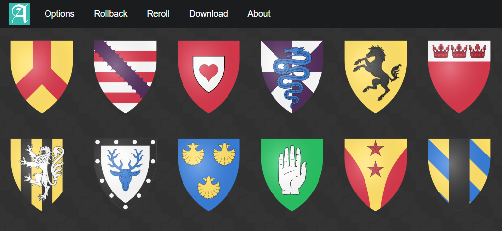
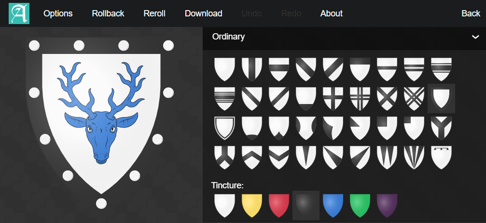

# Armoria

Armoria is a procedural heraldry generator and editor by Azgaar. It's both a serverless GUI tool and server-side API. It is also used as a part of the [Fantasy Map Generator](https://github.com/Azgaar/Fantasy-Map-Generator) project.

The GUI is available on [Vercel](https://armoria.vercel.app/). Join our [Reddit community](https://www.reddit.com/r/FantasyMapGenerator) and [Discord server](https://discordapp.com/invite/X7E84HU) to share your creations, discuss the tool, suggest ideas and get the most recent updates.

You can support the project on [Patreon](https://www.patreon.com/azgaar).

A tutorial is available [on Wiki](https://github.com/Azgaar/Armoria/wiki/Armoria-Tutorial). In case you want to help with translation, join the project on [Crowdin](https://crowdin.com/project/armoria).





## For Developers

The tool is almost zero-dependency vanilla JS based on [SvelteKit](https://github.com/sveltejs/kit). [Svelte](https://github.com/sveltejs/svelte) is a framework used for UI that compiles components to vanilla JS.

Pull requests are welcomed.

### Installation

Clone the repository and install the dependencies, then run `dev` to build and start the application in dev mode:

```
git clone https://github.com/Azgaar/Armoria.git
cd Armoria
npm install
npm run dev
```

Navigate to [localhost:5173](http://localhost:5173). You should see the app running. Edit a component file in `src`, save it, and reload the page to see your changes.

To create an optimised version run `npm run build`.

### Toolchain modernization

The #237 upgrades use the following mutually compatible pinned framework/rendering versions. Node 24 is declared in `.node-version` and `package.json`, and the Vercel adapter explicitly emits `nodejs24.x` functions.

| Package | Version |
| --- | --- |
| Svelte | 5.57.3 |
| SvelteKit | 3.1.1 |
| Vite / Svelte plugin | 8.3.5 / 7.3.1 |
| Vercel adapter | 7.0.2 |
| TypeScript | 6.0.3 |
| Puppeteer / puppeteer-core | 25.11.0 |
| Server Chromium package | 153.0.0 |

The browser and API renderer share the existing components in Svelte 5 legacy mode. The API now uses `render` from `svelte/server`; assets explicitly remain file URLs for Kit's server asset reader. Test helpers import public Svelte/store APIs rather than internal runtime paths. Existing event/accessibility warning filters use the renamed Svelte 5 codes; the 92 accessibility warnings remain visible in `npm run check`.

The #255 raster stack pairs Puppeteer/puppeteer-core 25.11.0 with Sparticuz Chromium 153.0.0 and its matching server archive. Puppeteer's pinned Chrome revision is 153.0.8010.36 ([supported browser mapping](https://pptr.dev/supported-browsers)). Keep these versions, the archive URL in `src/lib/api/raster.ts` and the CI browser installer aligned when upgrading. Node 24 remains the supported runtime.

PNG/JPEG/JPG API rendering now uses Puppeteer directly over CDP. One lazy browser startup is shared by concurrent requests, and each conversion owns a separate page that is closed on success or failure. Failed launches are retryable, disconnected browsers are replaced, and failed page cleanup discards the browser. All assets/fonts are embedded before conversion; raster-page JavaScript is disabled and network/file requests are blocked. PNG retains transparency; JPEG retains a white background and quality 100. SVG output and validation-before-browser-start behavior are unchanged.

`convert-svg-to-png`, `convert-svg-to-jpeg`, `convert-svg-core` and the converter patch are removed. The path polyfill now loads in `src/hooks.client.ts` before the editor mounts, so SSR/API imports no longer require its browser-global guard patch (#258). `patch-package` remains required for the independent deepmerge guard (#264). `test:raster-lifecycle` checks startup/concurrency/failure cleanup without launching Chrome, and real API raster tests verify dimensions/headers, concurrent palettes, SVG pixel parity for patterned artwork, transparency and embedded WOFF2 fonts. The font fixture is local and openly licensed, so these tests need no font network requests.

After `npm run build`, run `npm run test:production` for the service-worker update/offline regression against the actual production preview. CI runs this after the normal tests and build. Browser launch overrides work as documented below; no service credentials are required. A proxy changes only local deployment markers in HTML/worker scripts to exercise worker replacement, fresh online HTML and the latest cached offline view.

The #255 audit reports 22 advisories (3 low, 15 moderate, 4 high), down from 31 (3 low, 15 moderate, 13 high). The old extract-zip and proxy/basic-ftp paths are removed. The four remaining high entries propagate from one Zod advisory through `chromium-bidi 17.0.2 → zod 3.25.76`; Armoria explicitly uses CDP, not BiDi's Zod validation. The affected dependency remains installed, so the audit is not clean. #262 tracks adopting a compatible patched browser graph: Puppeteer 25.16.0 targets Chromium 156 while the current Sparticuz release provides 153. No unsupported Zod-major override is used. The other dependency groups remain under #256 (shared deepmerge/localization) and #257 (build/lint glob/minimatch), with overall progress tracked by #237.

The #256 mitigation guards both consumers of deepmerge 4.3.1 with a shared patch and pins svelte-i18n's esbuild dependency to 0.28.2. Install with lifecycle scripts enabled: `npm ci` applies the patches and fails if they cannot be applied. `patch-package` is required for the merge guard. The audit still reports 21 affected packages (4 low, 13 moderate, 4 high), including version-based deepmerge findings despite the local guard. See the [dependency review and before/after evidence](docs/dependency-audits/256.md) for reachability, upstream blockers and residual work. `test:dependency-security` and `test:localization` run in the service/browser suites; the latter uses an empty optimizer cache and verifies multiple locales, persistence, interpolation and storage recovery. The production offline check also verifies French translations.

The #257 build/lint update moves NFT to 1.11.1 and uses scoped overrides for glob 14.0.4 and minimatch 11.0.5 while their parents retain older major ranges. Matching, cancellation, tracing and lint-configuration regressions run in `test:dependency-security`; `test:production` also checks the emitted Vercel functions and assets. The [build/lint dependency review](docs/dependency-audits/257.md) records compatibility evidence and identical before/after deployment inventories. The audit drops to 9 affected package entries (5 low, 4 high), with no glob/minimatch findings; remaining deepmerge and BiDi/Zod work is tracked in #264 and #262. The existing 139 lint errors and 24 formatting failures remain separate from this update.

Shared and navigation components are migrating to Svelte 5 runes in reviewable batches under #259. The [migration checklist](docs/modernization/259.md) records the converted controls/notices and header menus, plus remaining page and dialog work. `test:navigation` checks responsive menus, nested controls, keyboard/touch behavior and message/notice lifecycle through `test:browser`.

The second #237 step upgrades SvelteKit to 3.1.1 and adapter-vercel to 7.0.2. Configuration now lives in `vite.config.ts`; `#lib` subpath imports include file extensions. URL synchronization uses shallow `goto` with `$app/state`. Private service variables are declared optional in `src/env.ts` and remain runtime values, so credential-free builds and procedural rendering still work. The service worker uses the new manifest/environment modules and has its own checked TypeScript project. Existing editor, image and production update/offline regressions validate the migration. `CoaSync` is the first component migrated to Svelte 5 runes, with FMG race and URL/undo regressions retained; other components continue in supported legacy mode. ESLint 10.14.0, typescript-eslint 8.72.1 and eslint-plugin-svelte 3.24.0 form the maintained lint toolchain, with `@eslint/js` declared directly. The existing repository-wide lint/format command is not a clean validation gate; CI uses strict type checks, regressions and the production build. Guidance: [SvelteKit 3 migration](https://svelte.dev/docs/kit/migrating-to-sveltekit-3).

### Branches, deployment and validation

The public Vercel app at https://armoria.vercel.app uses `sveltekit`, including the editor, image/claims API and Discord endpoint. The repository default branch remains `master`: it contains the legacy Rollup app and publishes `public` to `gh-pages` through its own master-only workflow. Keep changes to the Vercel application on `sveltekit`; do not use the legacy Pages deploy command for this branch. The open migration PR #188 tracks the branch transition.

Use Node 24 (declared in `.node-version`) and `npm ci`. No service credentials are needed for validation:

```sh
PUPPETEER_SKIP_DOWNLOAD=true npm ci
npx puppeteer browsers install chrome
npm run check
npm test
npm run build
npm run test:production
```

The browser installation command downloads Puppeteer's matching Chrome. On Linux, install any missing system libraries first; Puppeteer's `--install-deps` option requires root privileges. CI runs that installation through `sudo`, with an explicit shared browser cache, then runs all tests as the normal runner user. To use an existing Chromium installation instead, set `PUPPETEER_EXECUTABLE_PATH`. Restricted Linux containers may also require `PUPPETEER_NO_SANDBOX=1`; CI sets this only for its isolated test browser. `npm run test:services` runs API, claim/password, Discord, validation, settings, generation, file, lazy-database and raster lifecycle regressions. `npm run test:browser` runs SVG uploads, SVG/PNG/JPEG exports, copied links, imports/undo, rendering parity and saved-settings browser tests. `npm test` runs both groups sequentially so browser suites do not contend for shared development-server build caches. Individual `test:*` commands remain available below.

The SvelteKit validation workflow runs this check, complete regression suite and production build on pull requests and pushes to `sveltekit`, using `npm ci` and the declared Node version. It needs no repository secrets, database or Discord registration. Service tests use fake external services and browser tests use local assets and block external requests. Keep real credentials out of test environments.

Vercel's existing Git integration deploys upstream `sveltekit` commits. No environment variables are required for a basic build or procedural/explicit-COA image rendering. Runtime claims optionally require both `MONGO_ID` and `MONGO_PASS`; `MASTER_KEY` enables claim administrator access. `DISCORD_PUBLIC_KEY` enables signed Discord interactions; `ARMORIA_API_URL` optionally changes their image URL. Local command registration uses `DISCORD_APPLICATION_ID`, `DISCORD_BOT_TOKEN` and optionally `DISCORD_GUILD_ID`, and is never run in CI or a deployment build. See `.env.example` and the feature sections below.

After merging, inspect the upstream merge commit's Vercel deployment and compare the public domain's HTML/hashed assets with its successful deployment URL before closing the issue and updating #238. A fork preview may require maintainer authorization even when a later upstream deployment succeeds. GitHub currently labels these Vercel deployments Preview although the public domain serves them; the private domain/branch configuration remains unverified. This workflow validates the app and does not change hosting configuration. Because `sveltekit` is not the default branch, completed issues must be closed explicitly after verification.

### Type checking

Use Node 24 and the committed lockfile. From a clean checkout of `sveltekit`:

```sh
PUPPETEER_SKIP_DOWNLOAD=true npm ci
cp .env.example .env
npm run check
```

MongoDB credentials are optional. Checking and building do not connect to MongoDB or need administrator/Discord credentials. Keep your existing `.env` if already configured. `PUPPETEER_SKIP_DOWNLOAD` skips Chromium, which is unnecessary for checking; browser regressions can use `PUPPETEER_EXECUTABLE_PATH` as described below.

`npm run check` synchronizes SvelteKit's generated types and checks all application JavaScript, TypeScript and Svelte components with `strict` and `checkJs` enabled. The `Svelte and TypeScript check` workflow runs it for pull requests and pushes to `sveltekit`, without repository secrets. Type errors fail the check; compiler warnings remain visible.

The accessibility warning backlog is tracked separately from this type baseline. Existing click-only editor sections, thumbnails, close icons and toolbar actions need native buttons or links, keyboard activation and visible focus. Drag-only artwork/path handles need keyboard alternatives through the editor's numeric controls and explicit semantics. Upload drop zones already have file inputs; any eventual drag-event warning exception must be local and explain that alternative. The current 92 warnings comprise 42 missing keyboard handlers, 42 roles on click targets, four SVG artwork/handle roles, three drop-zone roles and one navigation-list interaction. Do not silence these categories globally or treat the passing type check as an accessibility audit. No new warning suppressions are part of this baseline. Run `npm run test:generation` and `npm run test:files` for the seed compatibility, weighted-table and upload-extraction regressions.

### Regression coverage

`npm test` runs the service and browser groups used by PR CI. All fixtures are local: claim tests use fake database records, Discord tests mock registration, browser tests block external requests, and image API tests replace raster converters with bounded fixtures. No suite needs production credentials or sends Discord messages.

| Behavior                                                                                                                                             | Commands                                                    |
| ---------------------------------------------------------------------------------------------------------------------------------------------------- | ----------------------------------------------------------- |
| Image inputs, dimensions/formats, palettes, inescutcheons, semy/pattern dependencies and legacy routes                                               | `test:api`, `test:render-limits`, `test:coa-validation`     |
| Harmless markup/SVG security fixtures and claim authentication/mutations                                                                             | `test:api`, `test:svg-upload`, `test:claims`                |
| Real editor change → undo/redo → copied link → reload; malformed/atomic imports                                                                      | `test:copied-links`, `test:coa-import`                      |
| Uploaded artwork, denied/quota-limited storage and custom generation settings                                                                        | `test:svg-upload`, `test:settings`, `test:settings-browser` |
| SVG/PNG/JPEG downloads, metadata and FMG fallback SVG                                                                                                | `test:exports`                                              |
| Rapid edits/undo during paused exports, out-of-order completion, export failure/recovery, unavailable charges, editor exit and closed/direct openers | `test:fmg-sync`                                             |
| API/browser pixel parity for fixed seeds and representative inescutcheon/pattern artwork                                                             | `test:pattern-rendering`                                    |
| Seed compatibility, independent request state and database-free startup                                                                              | `test:generation`, `test:api`, `test:database-startup`      |

FMG synchronization waits for editing to pause for 500 ms. Each change invalidates older pending exports, including undo to the already-sent original and leaving the editor. Only a current export can send a message; the opener is checked again after asynchronous work. A failed current SVG export still sends the blazon with an empty fallback, and subsequent edits can recover. The controlled browser tests pause blob reads after real SVG snapshots and release them out of order, then compare message blazons with embedded SVG metadata.

### Generation and render isolation

`generate(seed, tinctures?)` owns an Alea random stream and preserves the existing seeded artwork; it never replaces `Math.random`. Omitting a seed draws a new seed from ambient randomness, then uses the private stream. The domain generator defaults to built-in tincture weights. Gallery, editor and viewer pass their current browser weights explicitly. `createConfig(tinctures?, random?)` and the random-choice helpers also accept an explicit random source for independent or reentrant use.

API rendering snapshots the supplied palette before loading assets/fonts and passes palette, shield fallback, gradient, diaper and border settings through component props. It neither publishes request settings to editor stores nor depends on their current values. Browser components continue to use reactive editor settings. Selection handles render only in the editor.

`npm run test:generation` checks the unchanged 1,000-seed compatibility hash, random identity, explicit/reentrant choices and uploaded sampling tables. `npm run test:api` includes store-notification and paused/interleaved palette-isolation checks. Browser settings regressions verify custom generation weights in gallery, editor and viewer; rendering comparisons continue to check API/browser pixel parity.

### Optional claims database

Builds and module imports never connect to MongoDB. Explicit `coa` requests and numeric/random procedural seeds work without database configuration. Set both `MONGO_ID` and `MONGO_PASS` at server runtime to enable named claims using the existing Atlas cluster/database; credentials are URI-encoded. A nonnumeric seed looks up a claim before generating its fallback, so it requires the database too. An absent claim still generates normally, but missing configuration or an unavailable database returns safe, non-cacheable 503 JSON for named image requests and claim mutations instead of silently generating replacement artwork.

The first claim-dependent request connects lazily; concurrent requests share that attempt and successful requests reuse the client. Server selection and connection establishment each have a 5-second timeout; database operations have a 10-second timeout. A failed initial connection is closed and can be retried by a later request. The driver handles reconnection after an established connection loses service. Neither credentials nor driver error objects are returned to callers.

Run `npm run test:database-startup` for actual image/mutation route checks with a fake MongoDB driver: no startup connection, credential-free procedural/inline rendering, shared connection attempts, recovery and outage responses. PR CI runs these regressions and a production build without MongoDB credentials.

## Saved settings recovery

Saved settings are validated independently at startup. Missing or invalid values use defaults; valid zero values, including border width `0`, are preserved. Invalid entries in custom palettes, fonts and uploaded-charge maps do not discard valid entries. Recovery leaves the raw saved data untouched until the corresponding setting is edited or reset. A dismissible notice explains recovery or unavailable browser storage; failed reads/writes fall back to memory for the current tab, so editing can continue.

Numeric settings accept finite values within these ranges: gallery size 80–400 (integer), border width 0–4, export scale 0.1–4, and grid spacing 1–50 (integer). Tincture probabilities must be integer weights from 0–1000, with at most 256 entries and a total of at most 10,000 per group. Required pools must have positive totals; empty optional pools are allowed only when disabled for every element. Legacy sampling caches are ignored. The existing per-key storage format is unchanged, so no schema migration is needed.

Run `npm run test:settings` for parsing, validation and storage-failure checks, and `npm run test:settings-browser` for startup recovery, custom uploads, zero-width reloads and denied/quota-limited storage. The browser suite supports the Chromium options documented below and blocks external requests.

## Links and the address bar

While a coat of arms is edited, the `coa` URL parameter follows every change, so a reload or a shared address shows it as it is. The address, copied links, COA strings and JSON exports all carry the coat of arms as drawn here: with the shield it uses, and with every tincture recoloured or added in this browser written as its hex colour (`{"t1": "#0000ff"}`, or `vair-#0000ff-or` in a pattern), as the API accepts it. Default tinctures keep their names.

Copied edit and API links encode the raw COA JSON using `URLSearchParams`, preserving `&`, `+`, `#`, `%`, punctuation, Unicode, and custom hex tinctures. The copied edit link contains only the COA query parameter; session parameters and fragments from the editor address are not shared.

**Copy COA string** produces one percent-encoded JSON query value. It can be appended directly after `?coa=`. To read it as an object, use `JSON.parse(decodeURIComponent(copiedString))`. When constructing a link with `URLSearchParams`, pass `decodeURIComponent(copiedString)` to `searchParams.set("coa", ...)` so the already encoded value is not encoded a second time. A `coa` value returned by `searchParams.get("coa")` is already decoded and can be passed directly to `JSON.parse`.

URL loading, JSON imports, claim saves and API rendering use a shared runtime COA validator. Invalid links show an error and open the normal gallery. JSON imports must contain a non-empty array of at most 64 COAs, with a 2 MiB file limit and the per-COA limits below. Every entry is checked before the gallery or editor changes; rejection preserves artwork and undo/redo history.

The schema checks required tinctures, nested collections, supported identifiers, flags and numeric ranges. Legacy `0`/`1` flags are accepted; missing charge positions default to `e`, and missing inscription size/color/path default to `20`, `#000000` and `M-50 0 L50 0`. Missing shadow coordinates/blur default to zero and color to `#333333`. Browser imports can use locally registered charges, fonts and tinctures, and bounded compony effects; the API accepts built-in resources and continues to reject compony. A successful editor import occupies one undo step, including normalization.

Run `npm run test:coa-validation` for shared-schema checks and `npm run test:coa-import` for browser URL, file/drop, export round-trip and undo/redo regressions. The browser suite uses the Chromium options below and blocks external requests.

Run `npm run test:copied-links` with Puppeteer's Chromium installed, or set `PUPPETEER_EXECUTABLE_PATH` to a system browser. Restricted CI containers can also set `PUPPETEER_NO_SANDBOX=1`. The tests exercise the copy controls, capture clipboard writes without changing the system clipboard, and reopen an edit link in a fresh browser context. External network requests are blocked.

## API

The API allows to `GET` random or predefined vector and raster heraldic images of a given size.

For more details, see [the documentation](https://github.com/Azgaar/Armoria/wiki/Armoria-API).

Invalid COA JSON or unsupported COA elements return a JSON error with HTTP 400. Unexpected rendering or service failures return a generic HTTP 500 JSON error; raw request data and internal error details are not included. Claim authorization failures return HTTP 403 JSON errors, while successful claim/unclaim requests retain their HTML confirmation pages.

Run `npm run test:api` with Node 24 to check API error responses, SVG output escaping, and claim confirmations. The tests compile the actual routes and Svelte renderer, use local charge assets, and replace database access and raster conversion with test fixtures; they require no credentials or running services.

### Legacy image URLs and query overrides

`/api/:format/:size/[:seed]` redirects permanently (301) to `/api`, retaining query parameters and normalizing a legacy size such as `200px` to `200`. Path `format`, `size`, and (when present) `seed` take precedence over the same query parameters. When the path omits a seed, a query seed is retained; if both omit it, the API generates one. Duplicate core query parameters and oversized URLs are rejected before path values can replace them. Invalid effective dimensions or formats return the same JSON errors as `/api`.

For example, `/api/svg/200px/123?gules=123456` redirects to `/api?gules=123456&format=svg&size=200&seed=123` and renders a 200×200 SVG with the requested gules colour. A `coa` query supplies explicit artwork instead of looking up or generating the seed. A `shield` query overrides the shield of valid inline, claimed or generated artwork; absent an override, the artwork's shield (or `heater` default) is used. Shield names are case-sensitive, including `oldFrench`, and unsupported/empty names return 400. Palette query values retain the canonical API's six-digit hex format without `#`. The original COA and stored claims are not modified by these overrides.

`npm run test:api` follows the redirect into the real SVG renderer and checks final dimensions, field colour, shield geometry, COA text and precedence. `npm run test:render-limits` also verifies invalid shield overrides are rejected before database or rendering work.

### Image request limits

`GET /api` accepts `format=svg` (the default), `png`, `jpg`, or `jpeg`. `size` is a square dimension from **1 to 4096 pixels**, defaulting to 500 only when omitted. Decimal integer strings and a lowercase legacy `px` suffix are accepted (`400`, `400px`); the legacy `/api/svg/400px/example` redirect also works. Empty, zero, negative, fractional, non-finite, hexadecimal, and exponential values are rejected rather than silently defaulted or clamped. Format names are lowercase; duplicate `format`, `size`, `seed`, `coa`, or `shield` parameters are rejected.

Limits apply to submitted, stored, and generated COAs, including COAs submitted to the claim endpoint:

| Input | Limit |
| --- | --- |
| Encoded request URL | 64 KiB (hosting infrastructure may impose a lower limit) |
| Seed | 200 characters, matching claim-name length |
| COA JSON | 32 KiB UTF-8, checked before parsing and again after normalization |
| Structure | Depth 8 (root at 0), 2048 values, 64 properties per object, 64 items per array |
| Collections | 32 charges, 16 ordinaries, 16 inscriptions |
| Charge positions | 64 bytes per position string, 256 total distinct positions across charges |
| Fonts | 8 distinct inscription font names; repeated fonts are fetched once |
| Text | 4096 UTF-8 bytes per generic string/path, 1024 per inscription, 256 per identifier/tincture/name, 128 per font/property name |

Render-driving numeric fields must be finite numbers: zoom 0.1–1; charge/ordinary size 0.01–5, stretch −10–10, x/y −1000–1000, angle −360–360, stroke width 0–100; inscription size 1–100, spacing −10–100; shadow x/y −100–100 and blur 0–10. Gyronny is zero (disabled) or an even integer from 4–100. Nonzero compony ordinaries are rejected: that existing effect requires browser SVG geometry APIs and is not supported by the server renderer.

Invalid formats, dimensions, numbers, or malformed COAs return inert JSON with **400**. Excessive payload/COA complexity returns **413**; an oversized URL returns **414**. Supplied values are not echoed. Image-parameter validation precedes generation, and COA validation precedes asset/font loading; Chromium setup occurs only for a validated raster request. Limits also run at the renderer boundary so stored claims cannot bypass them. These are per-request bounds, not traffic rate limits.

The API resolves generic inescutcheons against the effective shield (default `heater`) and preserves camel-case shield names. Pattern definitions include ordinary secondary tinctures and all three charge tinctures, along with any semy charge dependencies, without duplicate definitions. SVG/PNG/JPEG downloads and FMG exports also follow nested SVG references so secondary-color patterns remain visible outside the editor.

Run `npm run test:pattern-rendering` with the Chromium options above to compare representative API SVGs with browser exports pixel for pixel and verify their internal references. It uses the real renderer and local assets, blocks external requests and requires no database credentials. `npm run test:api` also checks every built-in inescutcheon and all supported tincture slots.

Run `npm run test:render-limits` for allocation-free boundary and rejection tests, plus a deterministic sample of generated COAs. Raster converters and external services are replaced with fixtures; no large raster image is allocated.

### Claiming and releasing names

Claim mutations use `POST /api/claims/{name}` to create/update a claim and `DELETE /api/claims/{name}` to release it. Send `Content-Type: application/json` and keep credentials in the request body, over HTTPS. The old GET claim/unclaim URLs return **410 Gone** without reading or changing claims; they are not redirected. Clients using those URLs must migrate before deployment. Image GET requests are unchanged.

```js
// Create a protected claim, or update it using its existing password.
await fetch("https://armoria.vercel.app/api/claims/example", {
  method: "POST",
  headers: {"Content-Type": "application/json"},
  body: JSON.stringify({coa: {t1: "or"}, key: claimPassword})
});

// Release the claim.
await fetch("https://armoria.vercel.app/api/claims/example", {
  method: "DELETE",
  headers: {"Content-Type": "application/json"},
  body: JSON.stringify({key: claimPassword})
});
```

Creation returns 201; updates and deletions return 200. JSON responses contain status/name and, for POST, the public image URL and a `protected` flag. They never echo passwords, hashes, or submitted COA data and use `Cache-Control: no-store`. Invalid passwords return 403; missing claims on DELETE return 404; concurrent changes return 409 and require retrying. Names retain the existing lowercase normalization and cannot be numeric; the new endpoint limits names to 200 characters, passwords to 4096 UTF-8 bytes and JSON bodies to 64 KiB. Query parameters are not accepted.

Omitting `key` (or passing an empty string) when creating a claim makes it **unprotected**: anyone may update or delete it. Updating an existing claim preserves its current protection and password; supplying a key does not turn an existing public claim into a protected one. This retains the legacy behavior.

Administrators can update/delete existing claims using `Authorization: Bearer <MASTER_KEY>` instead of an owner password. Configure a nonempty `MASTER_KEY` in Vercel to enable this; absent/empty configuration grants no administrator access. The master key is no longer accepted as an owner password override and must not be used as a new claim's password. Administrator updates preserve the owner's credentials.

New passwords use salted scrypt hashes (`N=131072`, `r=8`, `p=1`, 16-byte salt, 32-byte derived key), via Node's asynchronous crypto API. These parameters follow the [OWASP password storage guidance](https://cheatsheetseries.owasp.org/cheatsheets/Password_Storage_Cheat_Sheet.html). Existing plaintext passwords still authorize owners. On the next authorized POST, the original password is hashed and its plaintext field is removed atomically with the artwork update, including when an administrator performs the update. DELETE removes the whole record. Inactive legacy records remain plaintext until updated or deleted; this is a gradual migration, not a bulk database rewrite. Old credential URLs can still exist in historical logs and browser history.

New records use deterministic MongoDB `_id` values to reject concurrent creation of the same normalized name. Legacy IDs remain unchanged. Updates/deletes match both the record ID and the credentials that were authorized, so a changed protection record causes a conflict. No index migration is required. Use an isolated database for preview deployments, and disable access to older deployments before migrating live records. Do not run the old mutation handlers alongside the new version: they cannot enforce hash-based protection. Roll back only to a version that understands `keyHash` or disables claim mutations.

Run `npm run test:claims`, `npm run test:api` and `npm run test:discord` with Node 24. Claim tests use real password hashing and storage helpers with an in-memory MongoDB fixture; no database credentials or live claims are needed.

## Live editing from Fantasy Map Generator

When Fantasy Map Generator opens an emblem for editing, Armoria receives `from=FMG`, a `session` token and `returnOrigin`. Every edit, undo, redo and tincture recolouring is then sent back to the map once editing pauses for half a second: Armoria posts `{type: "armoria:coa", version: 1, session, coa, svg}` to its opener at `returnOrigin`. `coa` is the edited blazon. A tincture recoloured or added here is sent as its hex colour, as the API accepts it (`{"t1": "#228833"}`, or `vair-#228833-or` in a pattern), so the map draws the shades shown in Armoria; default tinctures keep their names. `svg` is the complete SVG export, which the map uses when it cannot draw the blazon itself. The unchanged original is not sent, nor anything once the map tab is closed. The map accepts messages only from Armoria's origin with the live session token of that emblem. No message is sent when Armoria was opened directly.

## Alternatives

While Armoria is focused on coat of arms generation and UI simplicity, there are some alternatives that cover heraldry more precisely.

[Heraldry.Digital](https://github.com/heraldry/armory) aims to support most of the heraldry features and create a system able to convert between blazonry and metadata. It allows users to create much more complex coats of arms, while it is not a generator and can be hard to use.

[DrawShield](https://github.com/drawshield/Drawshield-Code) is another wonderful project. It allows to render a coat of arms taking the heraldic blazon as input.

## Discord command

`/armoria seed:barrulus` replies with `https://armoria.vercel.app/api?format=png&size=400&seed=barrulus`.
Vercel deploys `/discord` as a separate function, without the image renderer or MongoDB dependencies. The endpoint verifies Discord's signed HTTP interactions and returns the link immediately. It does not fetch the image or connect to MongoDB; Discord loads the image separately. The existing frontend, image API and Atlas database stay in place.

Use the existing Discord application if access is available, or create one in the [Discord Developer Portal](https://discord.com/developers/applications):

1. Set `DISCORD_PUBLIC_KEY` in the Vercel project's environment variables, using the application's **Public Key** from **General Information**, and redeploy. An optional `ARMORIA_API_URL` overrides the default `https://armoria.vercel.app/api`.
2. Set the application's **Interactions Endpoint URL** to `https://armoria.vercel.app/discord`. Discord verifies it by sending a signed PING. Receiving interactions over HTTP replaces Gateway interaction delivery for that application, so check any other commands before reusing an application.
3. Add `DISCORD_APPLICATION_ID` and `DISCORD_BOT_TOKEN` to your local `.env` (the variables are listed in `.env.example`). Keep the app's existing MongoDB variables. The bot token is used only for registration and is not needed on Vercel.
4. With Node 24, run `npm run discord:register`. It creates or updates only `/armoria` and leaves other commands registered. Set `DISCORD_GUILD_ID` for a test-server command, or omit it for a global command. Remove a guild test command when finished so it does not shadow the global one.
5. Open the installation URL printed by the script using an account allowed to add applications to the server, then invoke `/armoria`. The `applications.commands` scope is sufficient; no persistent bot process or message-content intent is needed.

Seeds must contain 1–100 characters without spaces; they are URL-encoded. The reply is public, while usage errors are private. Image previews depend on Discord settings and the image API's response time.

Run `npm run test:discord` with Node 24 to verify signatures, request handling, URL encoding and command registration without credentials or a database. Registration is never run as part of a deployment build.

References: [Discord interactions](https://docs.discord.com/developers/interactions/overview) and [application commands](https://docs.discord.com/developers/interactions/application-commands).


## License

The code is distributed under [MIT](https://opensource.org/licenses/MIT). Feel free to use it for any purpose.

Simple svg shapes and charges are self-made and available under [CC0](https://creativecommons.org/share-your-work/public-domain/cc0/). A lot of the complex charge renders are from [WappenWiki](http://wappenwiki.org) and available for [non-commercial use only](https://creativecommons.org/licenses/by-nc/3.0/). Check out the license details added to svg files and available on the _License_ screen on UI.

All images are manually optimized by me.

### SVG upload checks

Run `npm run test:svg-upload` with Node 24 and Puppeteer's Chromium installed. To use a system browser, set `PUPPETEER_EXECUTABLE_PATH` to its executable; restricted CI containers can additionally set `PUPPETEER_NO_SANDBOX=1`. The tests start their own local Vite server and block external requests; no database or credentials are required.

Custom SVG charges support static shapes, groups, transforms, secondary/tertiary colour classes, text, gradients, clipping/masks, and local fragment references. Supported inline presentation styles are retained. Scripts, HTML, animation, stylesheets, filters, and external resources are removed before preview, save, and rendering stored charges. Embedded PNG, JPEG, GIF, WebP, AVIF, and BMP images remain supported; SVG files should use the vector importer rather than the raster importer. Malformed SVG may be rejected, and unsupported artwork should be converted to paths or a raster image first.

### Browser export checks

Run `npm run test:exports` with Node 24 and Puppeteer's Chromium installed. The same `PUPPETEER_EXECUTABLE_PATH` and `PUPPETEER_NO_SANDBOX` options described above are supported. These browser tests disable `XSLTProcessor`, download and inspect SVG/PNG/JPEG files, check embedded COA metadata and inscription whitespace, and verify live SVG delivery to an FMG opener. External network requests are blocked.

Browser exports use `XMLSerializer` directly. No XSLT or XML formatting step is required, and whitespace-only inscription lines are preserved.
