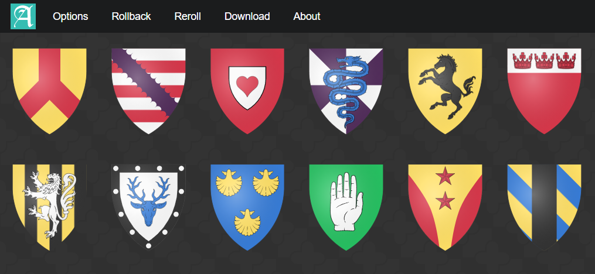
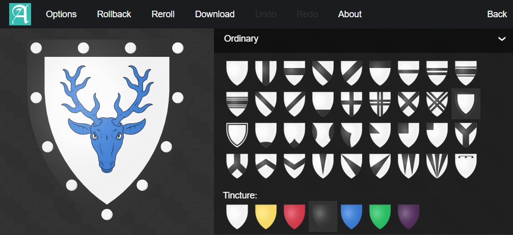

# Armoria

Armoria is a procedural heraldry generator and editor by Azgaar. It's both a serverless GUI tool and server-side API. It is also used as a part of the [Fantasy Map Generator](https://github.com/Azgaar/Fantasy-Map-Generator) project.

The GUI is available on [Vercel](https://armoria.vercel.app/). Join our [Reddit community](https://www.reddit.com/r/FantasyMapGenerator) and [Discord server](https://discordapp.com/invite/X7E84HU) to share your creations, discuss the tool, suggest ideas and get the most recent updates.

You can support the project on [Patreon](https://www.patreon.com/azgaar).

A tutorial is available [on Wiki](https://github.com/Azgaar/Armoria/wiki/Armoria-Tutorial). In case you want to help with translation, join the project on [Crowdin](https://crowdin.com/project/armoria).





## For Developers

The tool is almost zero-dependency vanilla JS based on [SvelteKit](https://github.com/sveltejs/kit). [Svelte](https://github.com/sveltejs/svelte) is a framework used for UI that compiles components to vanilla JS.

Pull requests are welcomed.

### Installation

Clone the repository and install the dependencies, then run `dev` to build and start the application in dev mode:

```
git clone https://github.com/Azgaar/Armoria.git
cd Armoria
npm install
npm run dev
```

Navigate to [localhost:5173](http://localhost:5173). You should see the app running. Edit a component file in `src`, save it, and reload the page to see your changes.

To create an optimised version run `npm run build`.

## Links and the address bar

While a coat of arms is edited, the `coa` URL parameter follows every change, so a reload or a shared address shows it as it is. The address, copied links, COA strings and JSON exports all carry the coat of arms as drawn here: with the shield it uses, and with every tincture recoloured or added in this browser written as its hex colour (`{"t1": "#0000ff"}`, or `vair-#0000ff-or` in a pattern), as the API accepts it. Default tinctures keep their names.

Copied edit and API links encode the raw COA JSON using `URLSearchParams`, preserving `&`, `+`, `#`, `%`, punctuation, Unicode, and custom hex tinctures. The copied edit link contains only the COA query parameter; session parameters and fragments from the editor address are not shared.

**Copy COA string** produces one percent-encoded JSON query value. It can be appended directly after `?coa=`. To read it as an object, use `JSON.parse(decodeURIComponent(copiedString))`. When constructing a link with `URLSearchParams`, pass `decodeURIComponent(copiedString)` to `searchParams.set("coa", ...)` so the already encoded value is not encoded a second time. A `coa` value returned by `searchParams.get("coa")` is already decoded and can be passed directly to `JSON.parse`.

URL loading, JSON imports, claim saves and API rendering use a shared runtime COA validator. Invalid links show an error and open the normal gallery. JSON imports must contain a non-empty array of at most 64 COAs, with a 2 MiB file limit and the per-COA limits below. Every entry is checked before the gallery or editor changes; rejection preserves artwork and undo/redo history.

The schema checks required tinctures, nested collections, supported identifiers, flags and numeric ranges. Legacy `0`/`1` flags are accepted; missing charge positions default to `e`, and missing inscription size/color/path default to `20`, `#000000` and `M-50 0 L50 0`. Missing shadow coordinates/blur default to zero and color to `#333333`. Browser imports can use locally registered charges, fonts and tinctures, and bounded compony effects; the API accepts built-in resources and continues to reject compony. A successful editor import occupies one undo step, including normalization.

Run `npm run test:coa-validation` for shared-schema checks and `npm run test:coa-import` for browser URL, file/drop, export round-trip and undo/redo regressions. The browser suite uses the Chromium options below and blocks external requests.

Run `npm run test:copied-links` with Puppeteer's Chromium installed, or set `PUPPETEER_EXECUTABLE_PATH` to a system browser. Restricted CI containers can also set `PUPPETEER_NO_SANDBOX=1`. The tests exercise the copy controls, capture clipboard writes without changing the system clipboard, and reopen an edit link in a fresh browser context. External network requests are blocked.

## API

The API allows to `GET` random or predefined vector and raster heraldic images of a given size.

For more details, see [the documentation](https://github.com/Azgaar/Armoria/wiki/Armoria-API).

Invalid COA JSON or unsupported COA elements return a JSON error with HTTP 400. Unexpected rendering or service failures return a generic HTTP 500 JSON error; raw request data and internal error details are not included. Claim authorization failures return HTTP 403 JSON errors, while successful claim/unclaim requests retain their HTML confirmation pages.

Run `npm run test:api` with Node 24 to check API error responses, SVG output escaping, and claim confirmations. The tests compile the actual routes and Svelte renderer, use local charge assets, and replace database access and raster conversion with test fixtures; they require no credentials or running services.

### Image request limits

`GET /api` accepts `format=svg` (the default), `png`, `jpg`, or `jpeg`. `size` is a square dimension from **1 to 4096 pixels**, defaulting to 500 only when omitted. Decimal integer strings and a lowercase legacy `px` suffix are accepted (`400`, `400px`); the legacy `/api/svg/400px/example` redirect also works. Empty, zero, negative, fractional, non-finite, hexadecimal, and exponential values are rejected rather than silently defaulted or clamped. Format names are lowercase; duplicate `format`, `size`, `seed`, or `coa` parameters are rejected.

Limits apply to submitted, stored, and generated COAs, including COAs submitted to the claim endpoint:

| Input | Limit |
| --- | --- |
| Encoded request URL | 64 KiB (hosting infrastructure may impose a lower limit) |
| Seed | 200 characters, matching claim-name length |
| COA JSON | 32 KiB UTF-8, checked before parsing and again after normalization |
| Structure | Depth 8 (root at 0), 2048 values, 64 properties per object, 64 items per array |
| Collections | 32 charges, 16 ordinaries, 16 inscriptions |
| Charge positions | 64 bytes per position string, 256 total distinct positions across charges |
| Fonts | 8 distinct inscription font names; repeated fonts are fetched once |
| Text | 4096 UTF-8 bytes per generic string/path, 1024 per inscription, 256 per identifier/tincture/name, 128 per font/property name |

Render-driving numeric fields must be finite numbers: zoom 0.1–1; charge/ordinary size 0.01–5, stretch −10–10, x/y −1000–1000, angle −360–360, stroke width 0–100; inscription size 1–100, spacing −10–100; shadow x/y −100–100 and blur 0–10. Gyronny is zero (disabled) or an even integer from 4–100. Nonzero compony ordinaries are rejected: that existing effect requires browser SVG geometry APIs and is not supported by the server renderer.

Invalid formats, dimensions, numbers, or malformed COAs return inert JSON with **400**. Excessive payload/COA complexity returns **413**; an oversized URL returns **414**. Supplied values are not echoed. Image-parameter validation precedes generation, and COA validation precedes asset/font loading; Chromium setup occurs only for a validated raster request. Limits also run at the renderer boundary so stored claims cannot bypass them. These are per-request bounds, not traffic rate limits.

Run `npm run test:render-limits` for allocation-free boundary and rejection tests, plus a deterministic sample of generated COAs. Raster converters and external services are replaced with fixtures; no large raster image is allocated.

### Claiming and releasing names

Claim mutations use `POST /api/claims/{name}` to create/update a claim and `DELETE /api/claims/{name}` to release it. Send `Content-Type: application/json` and keep credentials in the request body, over HTTPS. The old GET claim/unclaim URLs return **410 Gone** without reading or changing claims; they are not redirected. Clients using those URLs must migrate before deployment. Image GET requests are unchanged.

```js
// Create a protected claim, or update it using its existing password.
await fetch("https://armoria.vercel.app/api/claims/example", {
  method: "POST",
  headers: {"Content-Type": "application/json"},
  body: JSON.stringify({coa: {t1: "or"}, key: claimPassword})
});

// Release the claim.
await fetch("https://armoria.vercel.app/api/claims/example", {
  method: "DELETE",
  headers: {"Content-Type": "application/json"},
  body: JSON.stringify({key: claimPassword})
});
```

Creation returns 201; updates and deletions return 200. JSON responses contain status/name and, for POST, the public image URL and a `protected` flag. They never echo passwords, hashes, or submitted COA data and use `Cache-Control: no-store`. Invalid passwords return 403; missing claims on DELETE return 404; concurrent changes return 409 and require retrying. Names retain the existing lowercase normalization and cannot be numeric; the new endpoint limits names to 200 characters, passwords to 4096 UTF-8 bytes and JSON bodies to 64 KiB. Query parameters are not accepted.

Omitting `key` (or passing an empty string) when creating a claim makes it **unprotected**: anyone may update or delete it. Updating an existing claim preserves its current protection and password; supplying a key does not turn an existing public claim into a protected one. This retains the legacy behavior.

Administrators can update/delete existing claims using `Authorization: Bearer <MASTER_KEY>` instead of an owner password. Configure a nonempty `MASTER_KEY` in Vercel to enable this; absent/empty configuration grants no administrator access. The master key is no longer accepted as an owner password override and must not be used as a new claim's password. Administrator updates preserve the owner's credentials.

New passwords use salted scrypt hashes (`N=131072`, `r=8`, `p=1`, 16-byte salt, 32-byte derived key), via Node's asynchronous crypto API. These parameters follow the [OWASP password storage guidance](https://cheatsheetseries.owasp.org/cheatsheets/Password_Storage_Cheat_Sheet.html). Existing plaintext passwords still authorize owners. On the next authorized POST, the original password is hashed and its plaintext field is removed atomically with the artwork update, including when an administrator performs the update. DELETE removes the whole record. Inactive legacy records remain plaintext until updated or deleted; this is a gradual migration, not a bulk database rewrite. Old credential URLs can still exist in historical logs and browser history.

New records use deterministic MongoDB `_id` values to reject concurrent creation of the same normalized name. Legacy IDs remain unchanged. Updates/deletes match both the record ID and the credentials that were authorized, so a changed protection record causes a conflict. No index migration is required. Use an isolated database for preview deployments, and disable access to older deployments before migrating live records. Do not run the old mutation handlers alongside the new version: they cannot enforce hash-based protection. Roll back only to a version that understands `keyHash` or disables claim mutations.

Run `npm run test:claims`, `npm run test:api` and `npm run test:discord` with Node 24. Claim tests use real password hashing and storage helpers with an in-memory MongoDB fixture; no database credentials or live claims are needed.

## Live editing from Fantasy Map Generator

When Fantasy Map Generator opens an emblem for editing, Armoria receives `from=FMG`, a `session` token and `returnOrigin`. Every edit, undo, redo and tincture recolouring is then sent back to the map once editing pauses for half a second: Armoria posts `{type: "armoria:coa", version: 1, session, coa, svg}` to its opener at `returnOrigin`. `coa` is the edited blazon. A tincture recoloured or added here is sent as its hex colour, as the API accepts it (`{"t1": "#228833"}`, or `vair-#228833-or` in a pattern), so the map draws the shades shown in Armoria; default tinctures keep their names. `svg` is the complete SVG export, which the map uses when it cannot draw the blazon itself. The unchanged original is not sent, nor anything once the map tab is closed. The map accepts messages only from Armoria's origin with the live session token of that emblem. No message is sent when Armoria was opened directly.

## Alternatives

While Armoria is focused on coat of arms generation and UI simplicity, there are some alternatives that cover heraldry more precisely.

[Heraldry.Digital](https://github.com/heraldry/armory) aims to support most of the heraldry features and create a system able to convert between blazonry and metadata. It allows users to create much more complex coats of arms, while it is not a generator and can be hard to use.

[DrawShield](https://github.com/drawshield/Drawshield-Code) is another wonderful project. It allows to render a coat of arms taking the heraldic blazon as input.

## Discord command

`/armoria seed:barrulus` replies with `https://armoria.vercel.app/api?format=png&size=400&seed=barrulus`.
Vercel deploys `/discord` as a separate function, without the image renderer or MongoDB dependencies. The endpoint verifies Discord's signed HTTP interactions and returns the link immediately. It does not fetch the image or connect to MongoDB; Discord loads the image separately. The existing frontend, image API and Atlas database stay in place.

Use the existing Discord application if access is available, or create one in the [Discord Developer Portal](https://discord.com/developers/applications):

1. Set `DISCORD_PUBLIC_KEY` in the Vercel project's environment variables, using the application's **Public Key** from **General Information**, and redeploy. An optional `ARMORIA_API_URL` overrides the default `https://armoria.vercel.app/api`.
2. Set the application's **Interactions Endpoint URL** to `https://armoria.vercel.app/discord`. Discord verifies it by sending a signed PING. Receiving interactions over HTTP replaces Gateway interaction delivery for that application, so check any other commands before reusing an application.
3. Add `DISCORD_APPLICATION_ID` and `DISCORD_BOT_TOKEN` to your local `.env` (the variables are listed in `.env.example`). Keep the app's existing MongoDB variables. The bot token is used only for registration and is not needed on Vercel.
4. With Node 24, run `npm run discord:register`. It creates or updates only `/armoria` and leaves other commands registered. Set `DISCORD_GUILD_ID` for a test-server command, or omit it for a global command. Remove a guild test command when finished so it does not shadow the global one.
5. Open the installation URL printed by the script using an account allowed to add applications to the server, then invoke `/armoria`. The `applications.commands` scope is sufficient; no persistent bot process or message-content intent is needed.

Seeds must contain 1–100 characters without spaces; they are URL-encoded. The reply is public, while usage errors are private. Image previews depend on Discord settings and the image API's response time.

Run `npm run test:discord` with Node 24 to verify signatures, request handling, URL encoding and command registration without credentials or a database. Registration is never run as part of a deployment build.

References: [Discord interactions](https://docs.discord.com/developers/interactions/overview) and [application commands](https://docs.discord.com/developers/interactions/application-commands).


## License

The code is distributed under [MIT](https://opensource.org/licenses/MIT). Feel free to use it for any purpose.

Simple svg shapes and charges are self-made and available under [CC0](https://creativecommons.org/share-your-work/public-domain/cc0/). A lot of the complex charge renders are from [WappenWiki](http://wappenwiki.org) and available for [non-commercial use only](https://creativecommons.org/licenses/by-nc/3.0/). Check out the license details added to svg files and available on the _License_ screen on UI.

All images are manually optimized by me.

### SVG upload checks

Run `npm run test:svg-upload` with Node 24 and Puppeteer's Chromium installed. To use a system browser, set `PUPPETEER_EXECUTABLE_PATH` to its executable; restricted CI containers can additionally set `PUPPETEER_NO_SANDBOX=1`. The tests start their own local Vite server and block external requests; no database or credentials are required.

Custom SVG charges support static shapes, groups, transforms, secondary/tertiary colour classes, text, gradients, clipping/masks, and local fragment references. Supported inline presentation styles are retained. Scripts, HTML, animation, stylesheets, filters, and external resources are removed before preview, save, and rendering stored charges. Embedded PNG, JPEG, GIF, WebP, AVIF, and BMP images remain supported; SVG files should use the vector importer rather than the raster importer. Malformed SVG may be rejected, and unsupported artwork should be converted to paths or a raster image first.

### Browser export checks

Run `npm run test:exports` with Node 24 and Puppeteer's Chromium installed. The same `PUPPETEER_EXECUTABLE_PATH` and `PUPPETEER_NO_SANDBOX` options described above are supported. These browser tests disable `XSLTProcessor`, download and inspect SVG/PNG/JPEG files, check embedded COA metadata and inscription whitespace, and verify live SVG delivery to an FMG opener. External network requests are blocked.

Browser exports use `XMLSerializer` directly. No XSLT or XML formatting step is required, and whitespace-only inscription lines are preserved.
